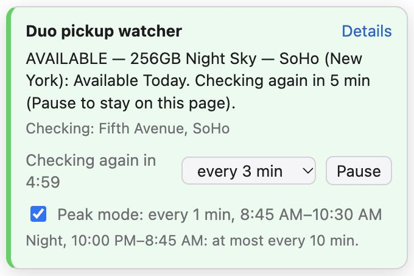

# Duo Pickup Watcher

A small Chrome extension that watches the iPhone Duo product page **you have open in your own browser** and alerts you when a nearby Apple Store shows pickup availability.

It makes no requests of its own. It reads the availability data Apple's page already loads, then reloads the page on a slow, randomized timer (default every 5 minutes). If Apple refuses a check, it stops checking for a while so the block can clear (see **When Apple blocks a check**).



> Not affiliated with or endorsed by Apple Inc. iPhone and Apple Store are trademarks of Apple Inc., registered in the U.S. and other countries.

## Setup (about 2 minutes)

1. In Chrome, open `chrome://extensions` and turn on **Developer mode** (top right).
2. Click **Load unpacked** and choose this `iphone-duo-tracker` folder.
3. Open the product page for the model you want. For example, 256GB Night Sky unlocked:
   `https://www.apple.com/shop/buy-iphone/iphone-duo/7.6-inch-display-256gb-night-sky-unlocked`
4. On that page, click **Check availability** (or "Pick up from Store") once and enter your ZIP code. Apple remembers it.
5. Leave the tab open. A "Duo pickup watcher" box in the bottom-right corner shows the status and a countdown to the next check.

## Peak mode (on by default)

Restock reports from third-party trackers such as InStockRadar (October–November 2026) suggest that many US store restocks land between roughly 9 and 10 AM local time and sell out within minutes. So from **8:45 to 10:30 AM** the watcher checks **every minute**. The rest of the day it uses the interval you pick in the box, and it times the last check before 8:45 so the peak isn't missed. Uncheck "Peak mode" in the box to turn it off.

## Night pace

From **10 PM until 8:45 AM** checks are at least **10 minutes** apart, whatever interval you pick. The check log showed Apple blocking the watcher (HTTP 541) after 2–3½ hours of checks every 1–2 minutes late at night, and those blocks lasted into the next morning's peak.

## When Apple blocks a check

Apple's bot protection answers with HTTP 541. Retrying every 30 minutes kept those blocks going for 9+ hours, so now the watcher **rests** instead: no checks at all until the next peak window (8:45 AM). If a block happens during the peak, it rests 1 hour, then 2, 4 and up to 8 hours if blocks keep coming. The box shows "(resting)" and the time it will try again; **Check now instead of resting** overrides it. After a block clears, checks stay at least 3 minutes apart for an hour.

The timer runs in the extension's background script (Chrome alarms). That keeps the randomized spacing intact while the tab is in the background, where Chrome would otherwise hold page timers to whole minutes.

## What it's checking

Under the status, the box shows the stores and the ZIP code (or the store you picked) from Apple's last pickup check, for example "Checking: Fifth Avenue · ZIP 10001". If Apple returned only one store, it says so. Re-enter your ZIP under **Check availability** to include more.

## Watching several models

Click **Details** in the box and tick the models you'd take, such as 256GB and 512GB in either color. On each check, the watcher loads the next ticked model's page (same carrier as the page you started on) instead of reloading the same one, so it still only reads what Apple's page loads. With 4 models and checks every minute, each model gets checked about every 4 minutes.

## History

**Details** also shows today's totals (checks, available, blocked, no data), the last time stock was seen, a chart of restocks by hour of day, and the last 15 checks. **Download CSV** saves the full log (up to 1,000 checks). Checks that found stock are also kept in a separate list (up to 1,000), so the chart looks back further than the log. In the chart, back-to-back checks that keep finding stock at the same store within 15 minutes count as one restock, and stores you've unticked don't count. **Clear history** empties both.

## Alerts

When stock appears, you get a desktop notification (click it to jump to the tab), a beep and a flashing tab title. Set these under **Details → Alerts**:

- **Phone alerts.** Install the free [ntfy](https://ntfy.sh) app on your phone and subscribe to a topic. Enter the same topic in the box (it suggests a random one, which stays the same across reloads) and click **Save & test**. Stock alerts arrive as urgent pushes; tapping one opens the product page. Anyone who knows a topic name can read it, so keep it long and random. The message goes through ntfy.sh's servers.
- **After an alert.** By default the watcher checks again 5 minutes after an alert, so a missed restock doesn't end the watch. Choose 3 or 10 minutes, or "stop checking" to stay on the page. Clicking **Pause** while the countdown runs also keeps you on the page.
- **Alert for these stores.** Every store seen in the history is listed. Untick the ones you wouldn't travel to; stock there is still logged (marked "ignored store") but doesn't alert.

## Stopped-watcher warning

If a tab's check was due more than 15 minutes ago and hasn't happened, the watcher first reloads that tab. That's all it takes after the Mac wakes from sleep, or when Chrome has discarded the tab, so no warning is sent. If checks still haven't resumed a few minutes later (the tab is gone, Chrome is stuck), you get a desktop notification and, if set up, a phone push, once. Closing the tab or pausing doesn't count. Each watched tab is tracked separately.

## Product page addresses

`https://www.apple.com/shop/buy-iphone/iphone-duo/7.6-inch-display-{SIZE}-{COLOR}-{CARRIER}`

- SIZE: `256gb`, `512gb`, `1tb`, `2tb`
- COLOR: `night-sky`, `star-white`
- CARRIER: `unlocked`, `att`, `t-mobile`, `verizon`

| Model | Night Sky | Star White |
|---|---|---|
| 256GB | MK1F4LL/A | MK1E4LL/A |
| 512GB | MK1H4LL/A | MK1G4LL/A |
| 1TB | MK1L4LL/A | MK1J4LL/A |
| 2TB | MK1R4LL/A | MK1Q4LL/A |

## Limits

- The Mac must be awake and Chrome open, with the tab not discarded. In Chrome settings, turn off Memory Saver for apple.com.
- Apple's response format isn't public. The parser has read a live "not available" response correctly, but hasn't yet seen a live "available" one. If the box says "Not available" while Apple's page clearly shows stock, the format differs.
- The box offers intervals from 1 to 15 minutes. Checking every 1–2 minutes all day is the setting most likely to trip Apple's bot protection, so prefer peak mode plus a longer interval the rest of the day.
- After updating the extension, click reload on it in `chrome://extensions` (it now needs the "alarms" permission and access to ntfy.sh), then refresh the Apple tab.

## Tests

Requires Node 18 or later. No dependencies to install.

```bash
npm test
```

That runs every file in `test/`. Each one also runs on its own, for example `node test/parse.test.js`. `test/harness.html` loads the watcher on a fake product page: serve the repo folder (for example `python3 -m http.server`), open `/test/harness.html`, and run `fetch('/test/shop/fulfillment-messages')` from the page to feed it the sample response in `test/shop/`.

## Responsible use

This is for people trying to buy a phone for themselves. It runs only in your own browser, on a page you opened, and it backs off when Apple pushes back. Please don't turn it into something that hammers Apple's servers, runs many accounts or reserves stock for resale. Using it is at your own risk and subject to Apple's terms of use.

## Contributing

See [CONTRIBUTING.md](CONTRIBUTING.md). The most useful contribution right now is a real "available" response from Apple.

## License

[MIT](LICENSE)
